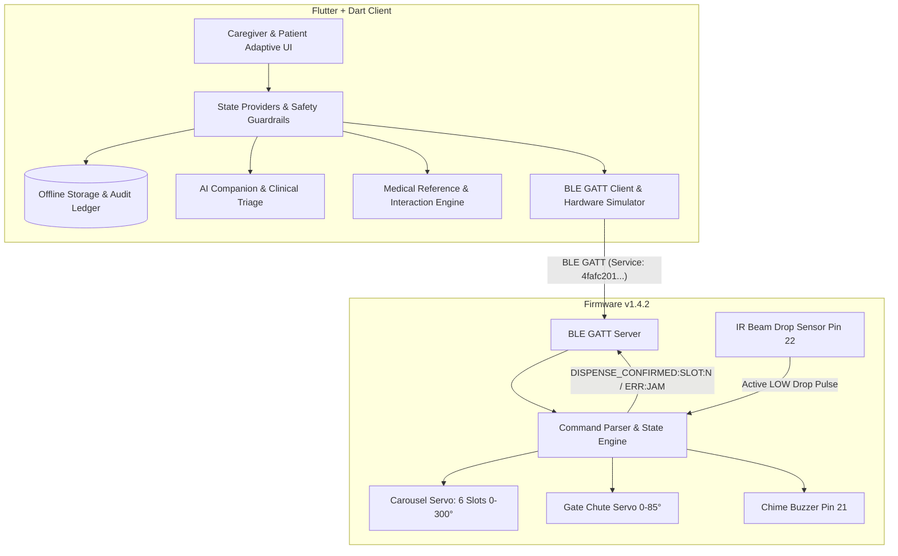

# CAREMATE — Advanced AI Healthcare Companion & Assistive Robotics Ecosystem

CAREMATE is a home healthcare companion platform connecting an Android application with an ESP32-powered pill-dispensing companion robot via Bluetooth Low Energy (BLE).

---

## 1. System Architecture



---

## 2. Truthful Dispensing State Machine

CAREMATE strictly enforces non-conflated state transitions:

```
[SCHEDULED] 
      │
      ▼  (User/Schedule triggers dispense, checks connection & non-jam)
[COMMAND_SENT]
      │
      ├── (Optical IR sensor detects tablet drop within 2.5s) ──► [DISPENSE_CONFIRMED]
      │                                                                  │
      │                                                                  ▼ (Patient takes medicine)
      │                                                            [ACKNOWLEDGED]
      │
      └── (Sensor timeout / Jam / BLE disconnect) ──────────────► [FAILED / UNKNOWN]
```

- **Safety Guard:** Duplicate commands are blocked for 45 minutes to prevent accidental double dosing.
- **Stock Tracking:** Compartment inventory is only deducted when `DISPENSE_CONFIRMED` is reported by the hardware.

---

## 3. BLE GATT Protocol Specification

- **Service UUID:** `4fafc201-1fb5-459e-8fcc-c5c9c331914b`
- **RX Characteristic (Write from App):** `beb5483e-36e1-4688-b7f5-ea07361b26a8`
- **TX Characteristic (Notify to App):** `beb5483f-36e1-4688-b7f5-ea07361b26a8`

| Command | Direction | Payload Example | Description |
|---|---|---|---|
| `STATUS` | App -> Robot | `STATUS` | Request telemetry: active slot, battery, jam, gate |
| `STATUS:OK...` | Robot -> App | `STATUS:OK\|SLOT:2\|BAT:94\|JAM:0\|GATE:0` | Periodic heartbeat telemetry |
| `DISPENSE_SLOT:<N>` | App -> Robot | `DISPENSE_SLOT:2` | Rotate carousel to slot 1-6, open gate, detect drop |
| `STATE:ROTATING...` | Robot -> App | `STATE:ROTATING_SLOT:2` | Informs app of mechanical transit |
| `DISPENSE_CONFIRMED`| Robot -> App | `DISPENSE_CONFIRMED:SLOT:2`| Physical IR sensor confirmed tablet fell into tray |
| `TEST_BUZZER` | App -> Robot | `TEST_BUZZER` | Plays 3-tone chime for patient reminder |
| `CALIBRATE` | App -> Robot | `CALIBRATE` | Returns carousel to home Slot 1 and clears state |
| `EMERGENCY_STOP`| App -> Robot | `EMERGENCY_STOP` | Immediately closes gate and shuts down motors |

---

## 4. Hardware Wiring Diagram (ESP32 DevKit V1)

| ESP32 Pin | Component | Description |
|---|---|---|
| **GPIO 18** | Carousel Servo (PWM) | Rotates 6-slot pill wheel (0°, 60°, 120°, 180°, 240°, 300°) |
| **GPIO 19** | Dispense Gate Servo (PWM) | Controls release chute door (Closed: 0°, Open: 85°) |
| **GPIO 21** | Piezo Buzzer | Reminder chimes and emergency jam alerts |
| **GPIO 22** | Optical / IR Drop Sensor | Detects tablet drop into tray (Input Pullup, Active LOW) |
| **GPIO 2** | Onboard LED | BLE connection indicator |
| **VIN / 5V** | External 5V 2A Power Supply | Powers servos and controller |
| **GND** | Common Ground | Connected to power supply ground and sensors |

The complete production firmware is located at:
`d:\CAREMATE\firmware\caremate_esp32_firmware.ino`

---

## 5. Built Artifacts & Verification

- **Production APK:** `d:\CAREMATE\outputs\caremate-app.apk`
- **Signature Schemes:** APK Signature Scheme v1 (JAR) + Scheme v2 verified (`apksigner`).
- **Static Analysis:** `flutter analyze` completed with 0 errors and 0 warnings.
- **Unit & Clinical Safety Tests:** 5/5 test suites passed.

---

## 6. How to Install & Run

### Installing the APK on an Android Device
1. Connect your Android phone with USB debugging enabled:
   ```bash
   adb install -r d:\CAREMATE\outputs\caremate-app.apk
   ```
2. Or transfer `d:\CAREMATE\outputs\caremate-app.apk` to your phone via USB or Google Drive and install using your phone's file manager.

### Running with Flutter Locally
```bash
cd d:\CAREMATE\caremate_app
flutter run -d chrome     # Run in Chrome browser with full interactive simulation
flutter run               # Run on connected Android device
```
